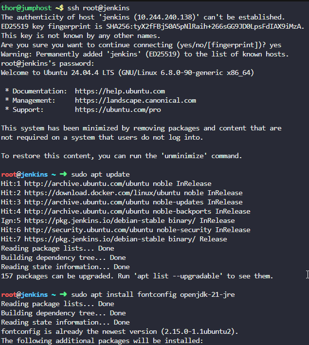
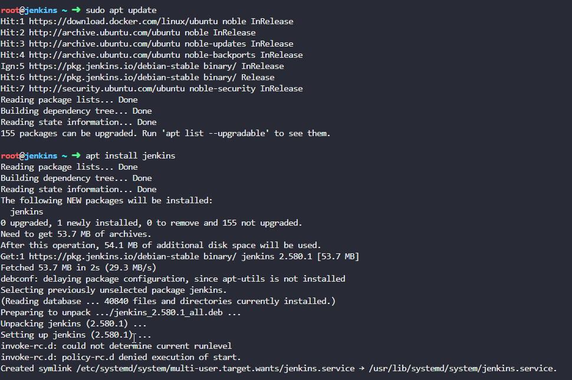
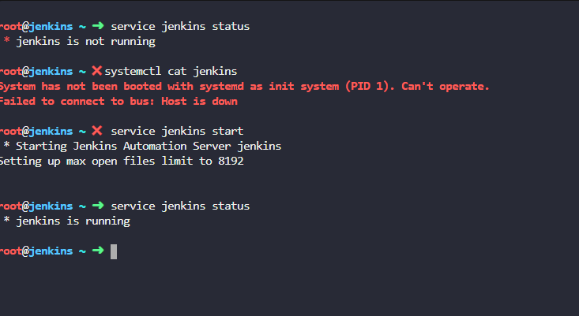
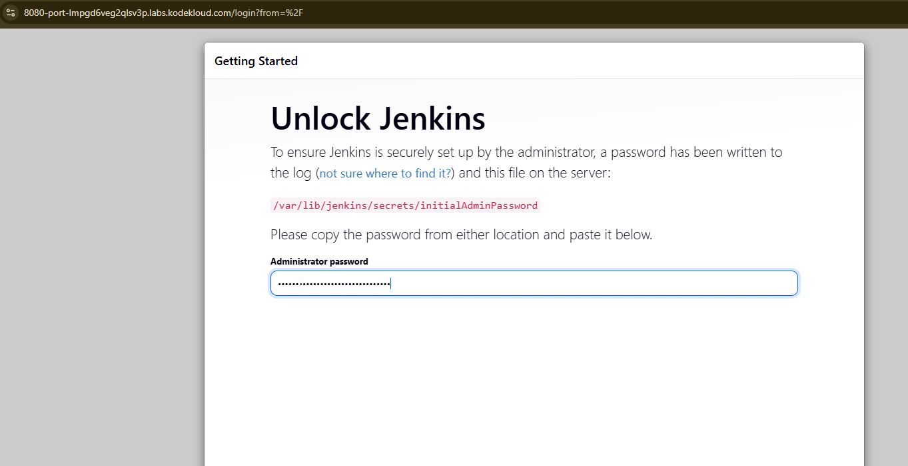
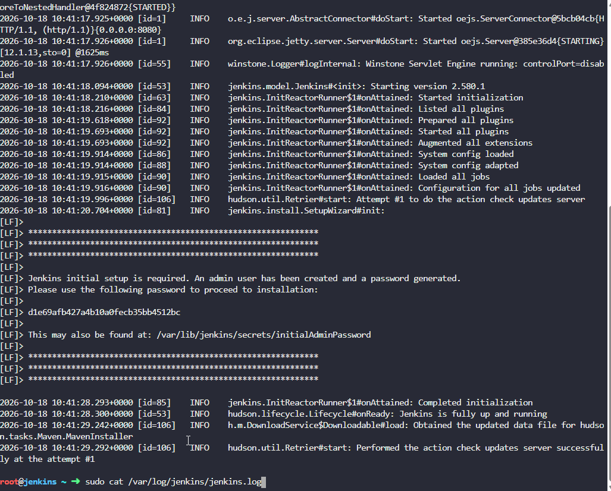
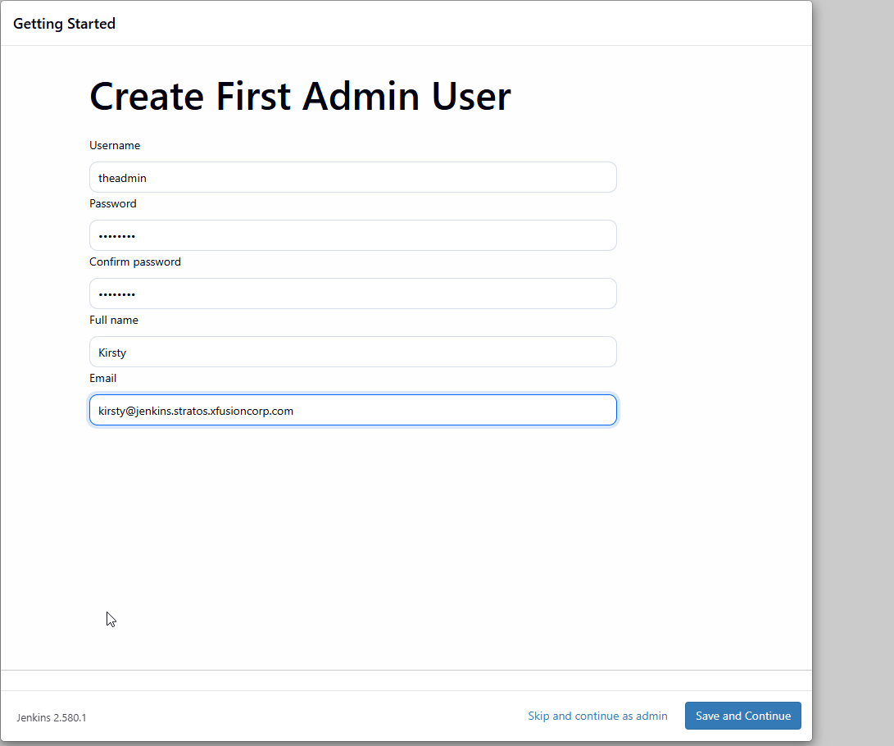

# Set Up Jenkins Server


The DevOps team at xFusionCorp Industries is initiating the setup of CI/CD pipelines and has decided to utilize Jenkins as their server. Execute the task according to the provided requirements:


1. Install Jenkins on the jenkins server using the apt utility only, and start it using the service command.

If you face a timeout issue while starting the Jenkins service, first check the service status with service jenkins status
Then review the logs in /var/log/jenkins/jenkins.log to identify the cause.
2. Jenkin's admin user name should be theadmin, password should be Adm!n321, full name should be Kirsty and email should be kirsty@jenkins.stratos.xfusioncorp.com.


```bash
sudo apt update
sudo apt install fontconfig openjdk-21-jre
java -version

```



```bash
sudo wget -O /etc/apt/keyrings/jenkins-keyring.asc \
  https://pkg.jenkins.io/debian-stable/jenkins.io-2026.key
echo "deb [signed-by=/etc/apt/keyrings/jenkins-keyring.asc]" \
  https://pkg.jenkins.io/debian-stable binary/ | sudo tee \
  /etc/apt/sources.list.d/jenkins.list > /dev/null
```

```bash
sudo wget -O /etc/apt/keyrings/jenkins-keyring.asc \
  https://pkg.jenkins.io/debian/jenkins.io-2026.key
echo "deb [signed-by=/etc/apt/keyrings/jenkins-keyring.asc]" \
  https://pkg.jenkins.io/debian binary/ | sudo tee \
  /etc/apt/sources.list.d/jenkins.list > /dev/null
sudo apt update
sudo apt install jenkins
```



```bash
sudo service jenkins start
sudo service jenkins status

```






