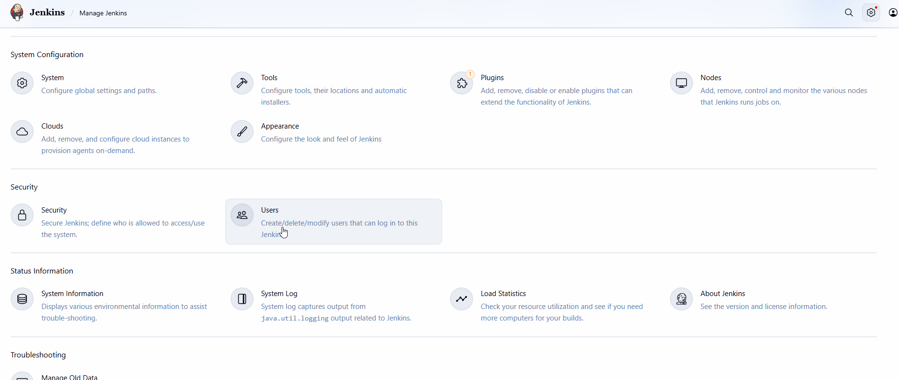
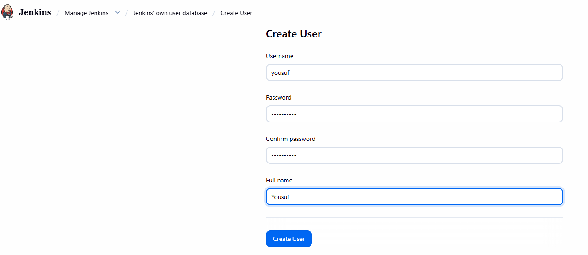
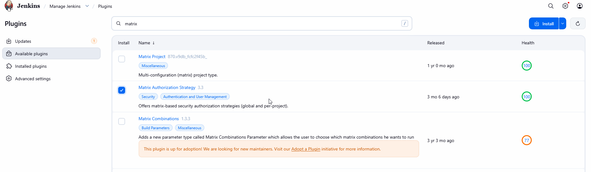
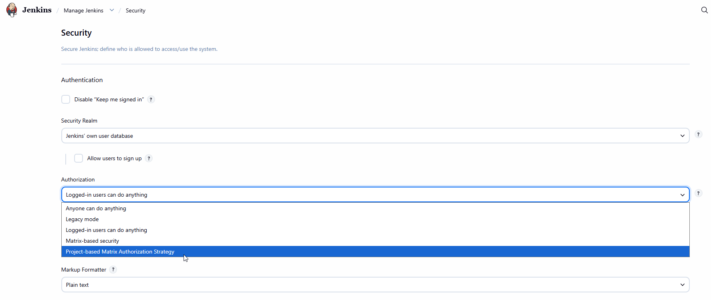
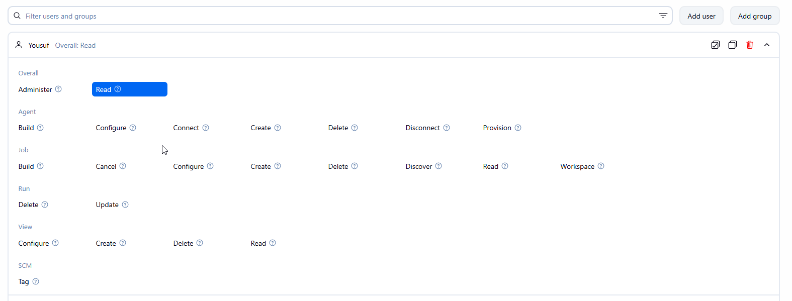
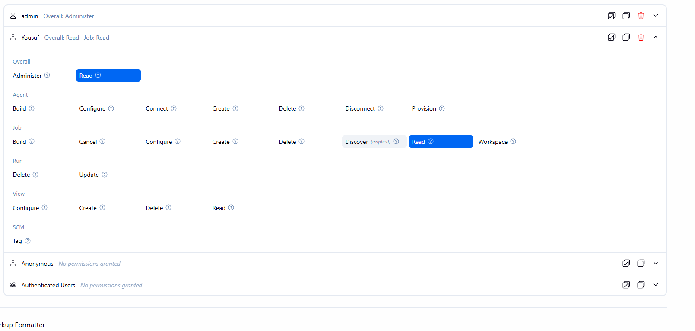

# Configure Jenkins User Access

The Nautilus team is integrating Jenkins into their CI/CD pipelines. After setting up a new Jenkins server, they're now configuring user access for the development team, Follow these steps:

1. Click on the Jenkins button on the top bar to access the Jenkins UI. Login with username admin and password Adm!n321.

2. Create a jenkins user named yousuf with the password LQfKeWWxWD. Their full name should match Yousuf.

3. Utilize the Project-based Matrix Authorization Strategy to assign overall read permission to the yousuf user.

4. Remove all permissions for Anonymous users (if any) ensuring that the admin user retains overall Administer permissions.

5. For the existing job, grant yousuf user only read permissions, disregarding other permissions such as Agent, SCM etc.

Note:

1. You may need to install plugins and restart Jenkins service. After plugins installation, select Restart Jenkins when installation is complete and no jobs are running on plugin installation/update page.

