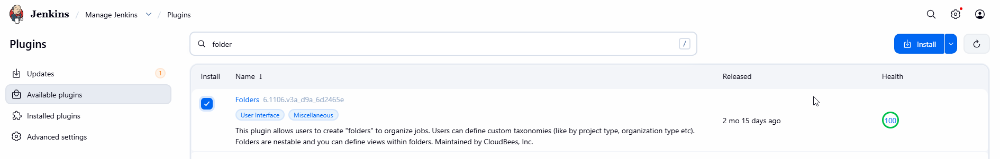
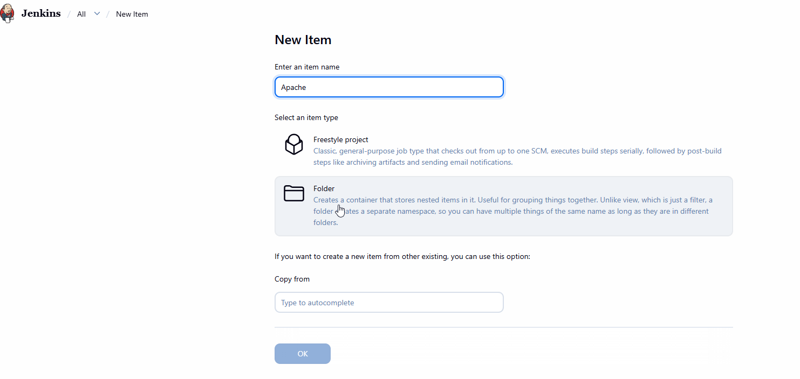
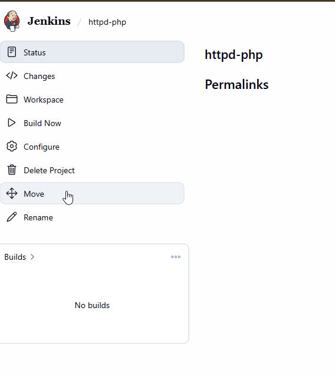
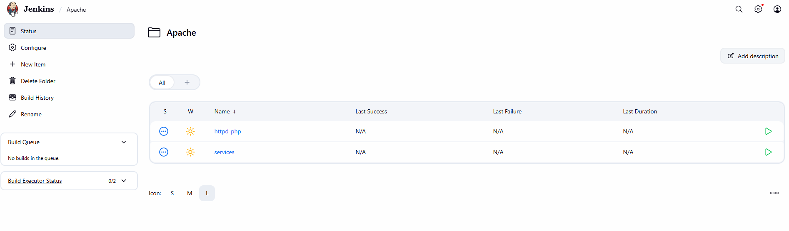

# Organize Jenkins Jobs with Folders

xFusionCorp Industries' DevOps team aims to streamline the management of Jenkins jobs by organizing them into distinct folders based on their purpose. Complete the task following the provided requirements:

1.Access the Jenkins UI by clicking on the Jenkins button in the top bar. Log in using the credentials: username admin and password Adm!n321.

2. Create a new folder named Apache within the Jenkins UI.

3. Move the existing jobs httpd-php and services under the newly created Apache folder.

For each existing job:
1. Return to the Jenkins dashboard.
2. Open the job (httpd-php first).
3. Select Move from the job's left-side menu. Depending on your Jenkins version and installed plugins, it may be available under another menu.
4. Select Apache as the destination folder.
5. Confirm the move.
6. Repeat for the services job.

