# Configure Jenkins Job for Package Installation

Some new requirements have come up to install and configure some packages on the Nautilus infrastructure under Stratos Datacenter. The Nautilus DevOps team installed and configured a new Jenkins server so they wanted to create a Jenkins job to automate this task. Find below more details and complete the task accordingly:

1. Access the Jenkins UI by clicking on the Jenkins button in the top bar. Log in using the credentials: username admin and password Adm!n321.

2. Create a new Jenkins job named install-packages and configure it with the following specifications:

Add a string parameter named PACKAGE.

Configure the job to install a package specified in the $PACKAGE parameter on the storage server (Stratos Datacenter).

Build the job at least once (e.g. with parameter PACKAGE=vim-enhanced) so the package is installed on the Storage server and can be verified.

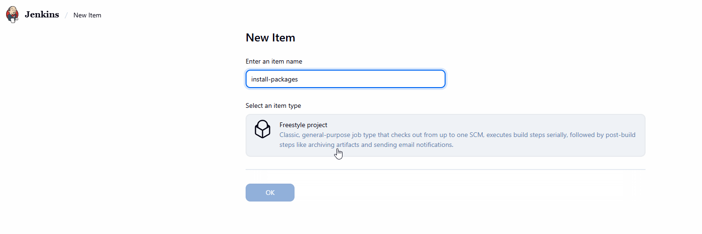

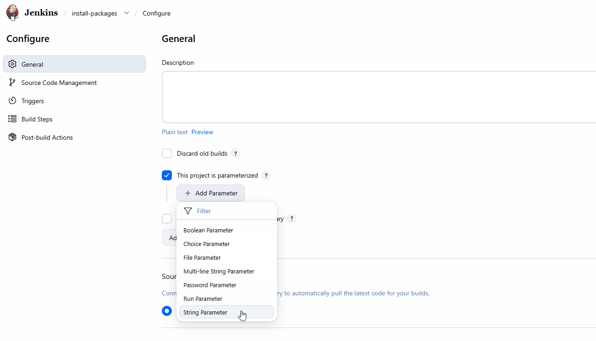

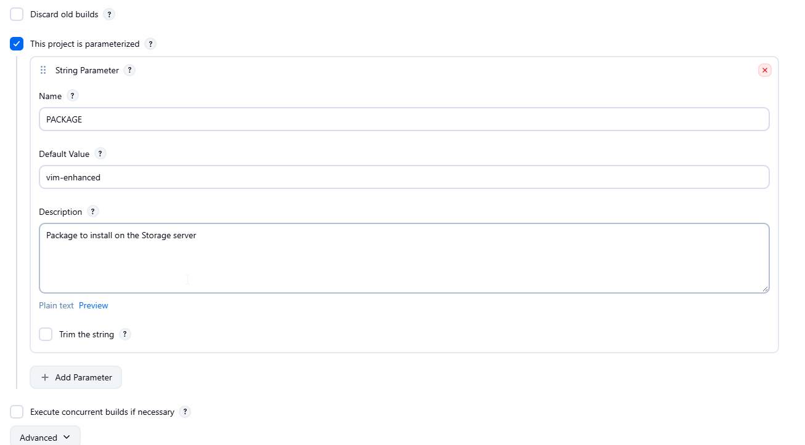

Plugin Installation Process:

1. Navigate to: Manage Jenkins → Plugins
2. Select: Available Plugins tab
3. Search for: "ssh", "ssh credentials", "ssh build agents"
4. Install the following plugins:
   - SSH Plugin
   - SSH Credentials Plugin
   - SSH Build Agents Plugin
5. Select: Restart Jenkins when installation is complete and no jobs are running

Plugin Details:

SSH Plugin: Enables executing commands on remote servers via SSH.
SSH Credentials Plugin: Manages SSH credentials for secure connections.
SSH Build Agents Plugin: Supports SSH-based build agents for remote execution.
Post-Installation: Jenkins restarts to apply plugins.

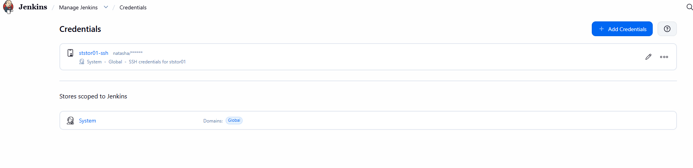

SSH Host Configuration Process:

1. Navigate to: Manage Jenkins → System
2. Scroll to: SSH remote hosts
3. Add Host:
   - Hostname: ststor01
   - Credentials: Select natasha (ststor01-ssh credentials)
4. Click: Check Connection
5. Verify: Connection successful
6. Click: Save

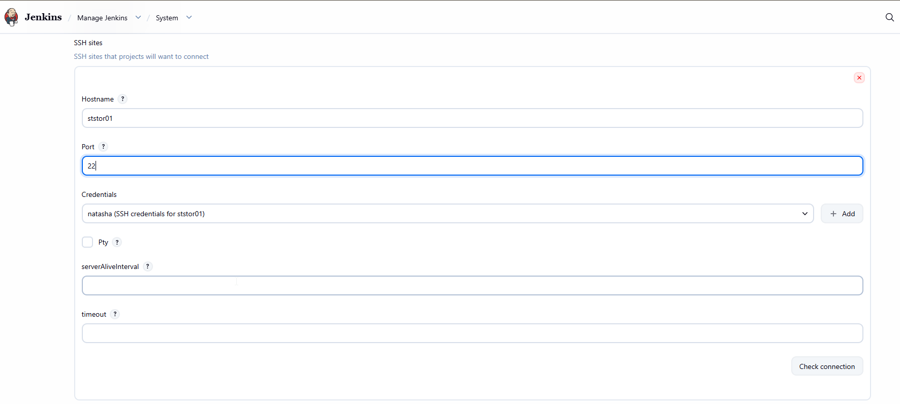

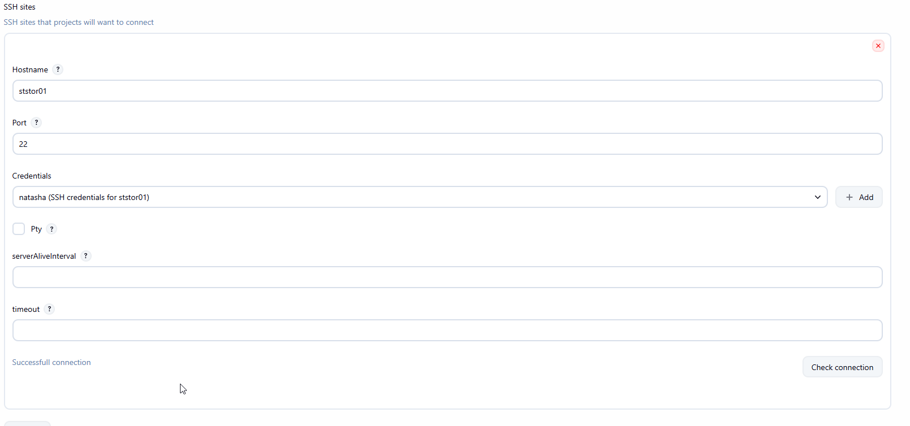

1. Create the Jenkins job
   1. Click Jenkins in the top bar and log in with username admin and password Adm!n321.
   2. Click New Item.
   3. Enter install-packages as the job name.
   4. Select Freestyle project, then click OK.
   5. Under General, check This project is parameterized.
   
2. Click Add Parameter → String Parameter and configure:
   - Name: PACKAGE
   - Default Value: vim-enhanced
   - Description: Package to install on the Storage server
3. Configure the build step

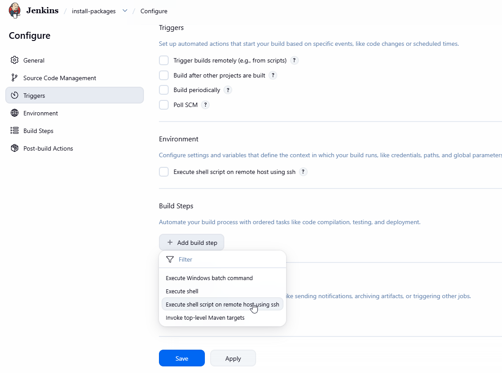

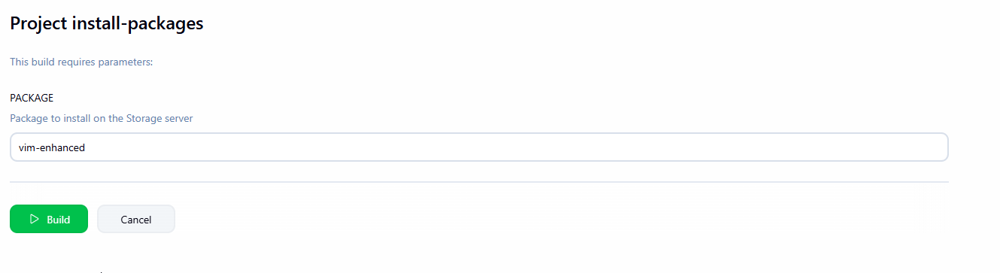

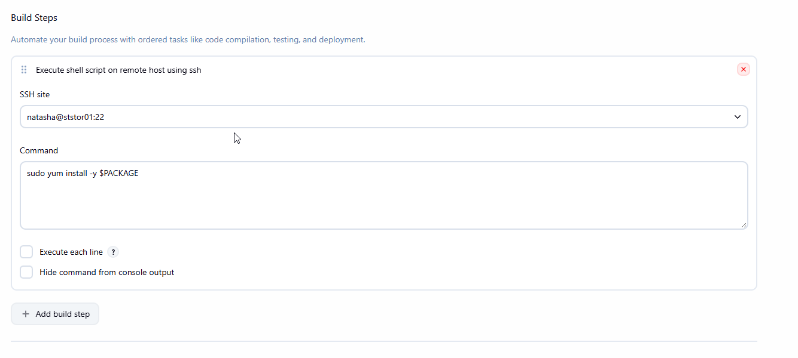

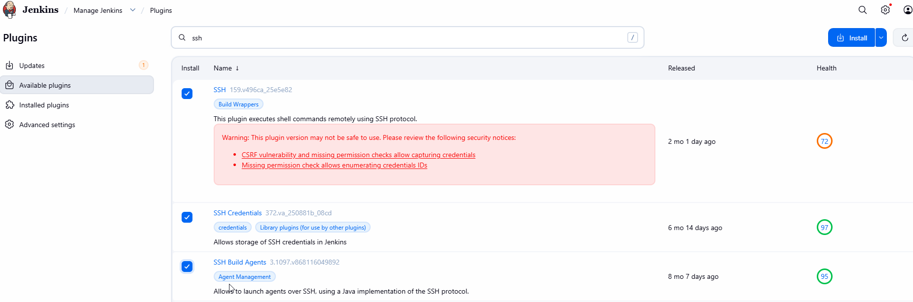

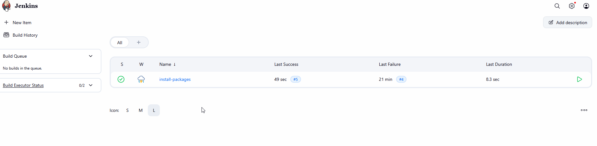

Validation on Storage Server (via terminal):

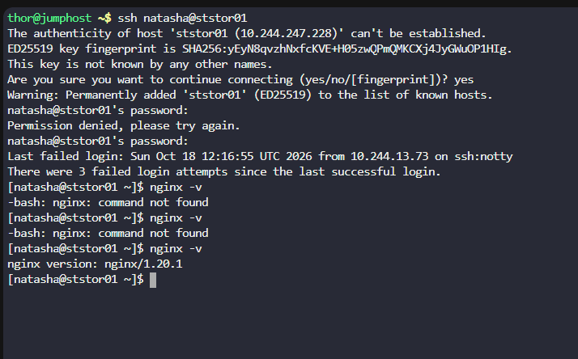

