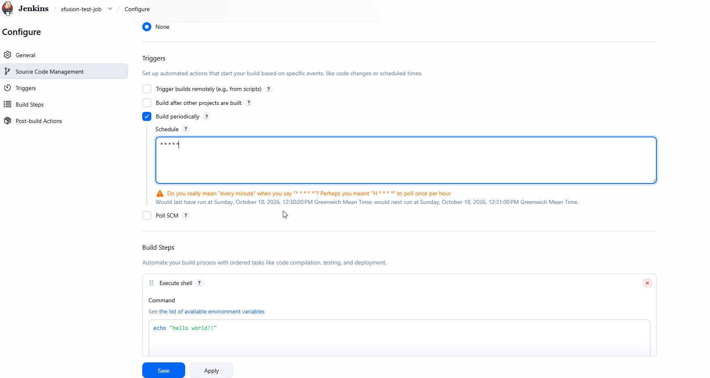
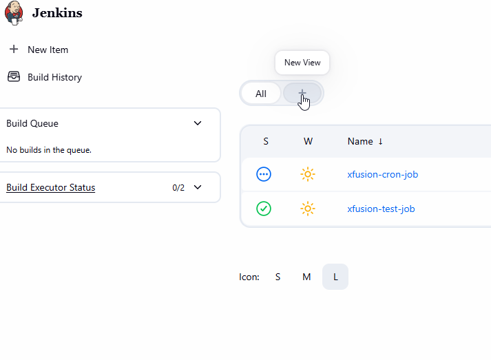
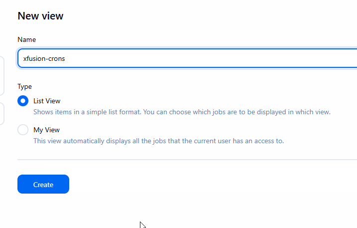
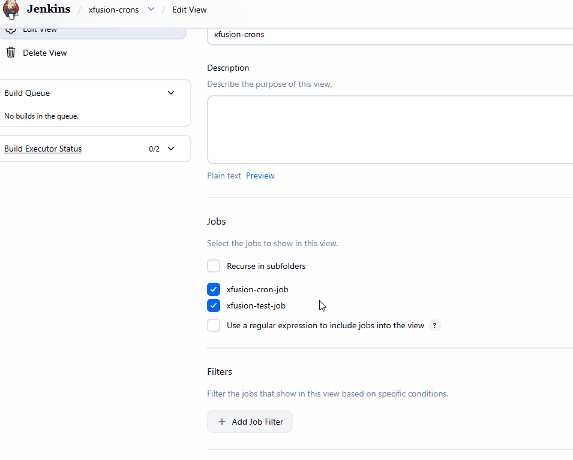
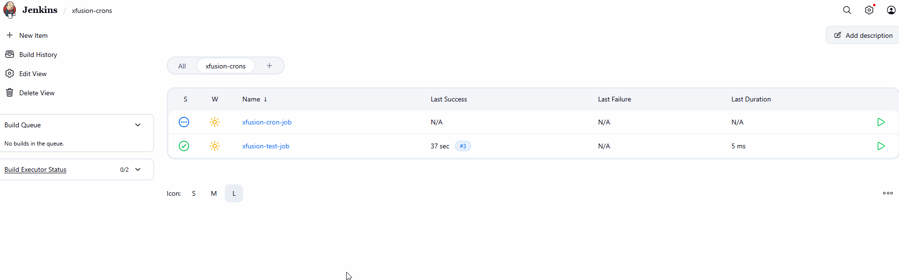

# Jenkins Views

The DevOps team of xFusionCorp Industries is planning to create a number of Jenkins jobs for different tasks. So to easily manage the jobs within Jenkins UI they decided to create different views for all Jenkins jobs based on usage/nature of these jobs, - for example xfusion-crons view for all cron jobs. Based on the requirements shared below please perform the below mentioned task:

Click on the Jenkins button on the top bar to access the Jenkins UI. Login using username admin and password Adm!n321.

1. Create a Jenkins job named xfusion-test-job.

2. Configure this job to run a simple bash command i.e echo "hello world!!".

3. Create a view named xfusion-crons (it must be a global view of type List View) and make sure xfusion-test-job and xfusion-cron-job (which is already present on Jenkins) jobs are listed under this new view.

4. Schedule this newly created job to build periodically at every minute i.e * * * * * (please make sure to use the cron expression exactly same how it is mentioned here).

5. Make sure the job builds successfully.

